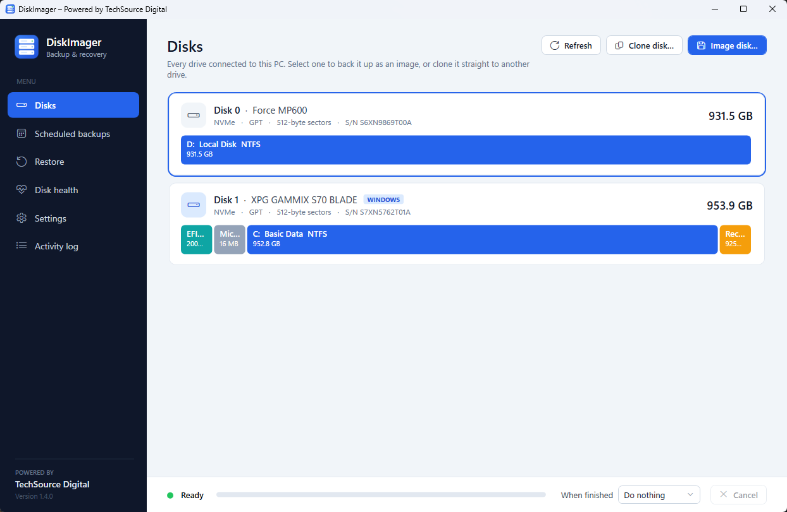
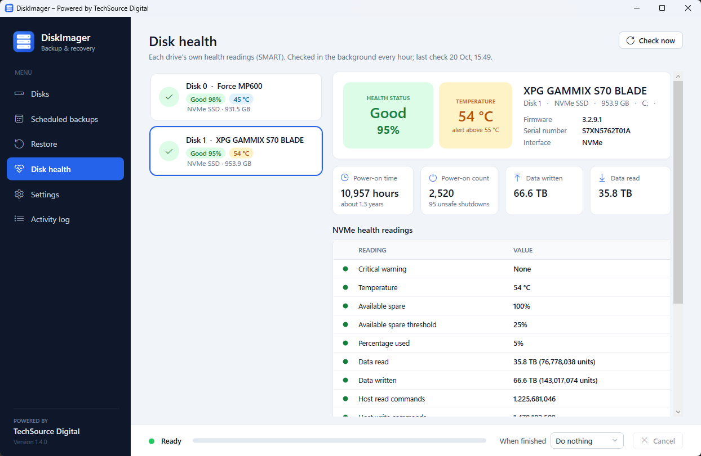
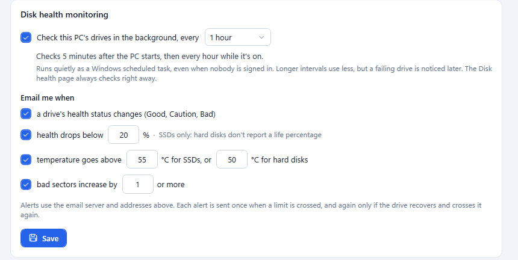
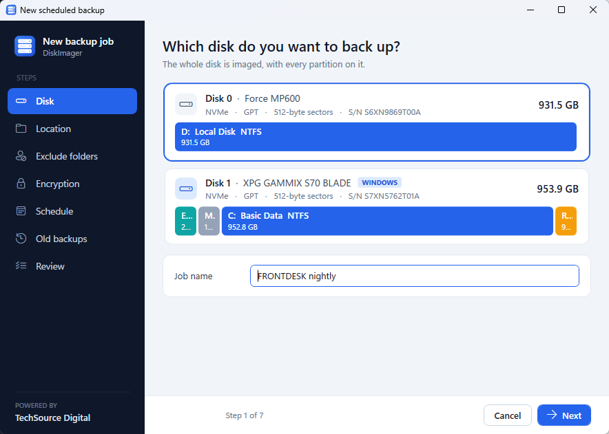
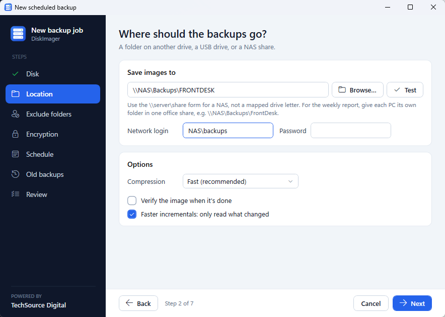
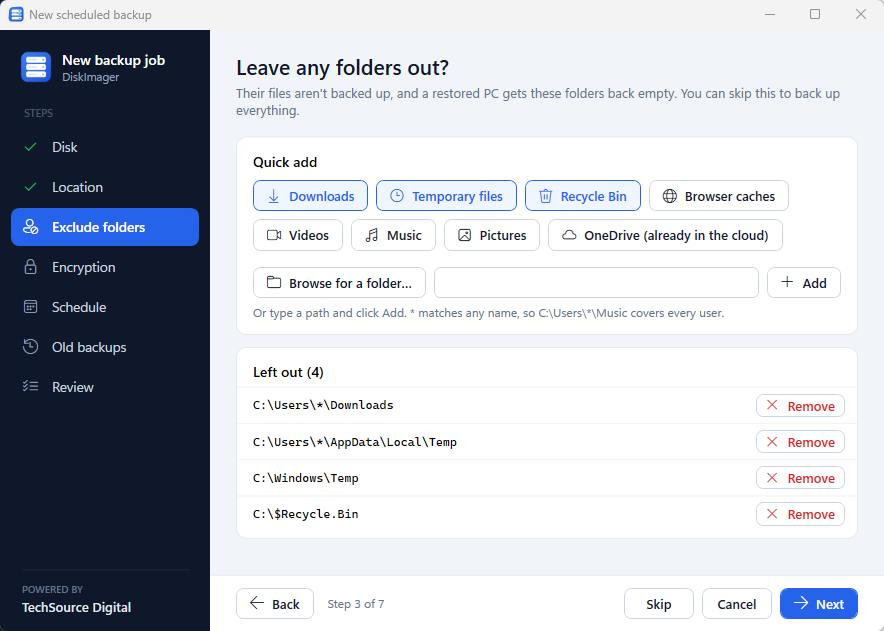
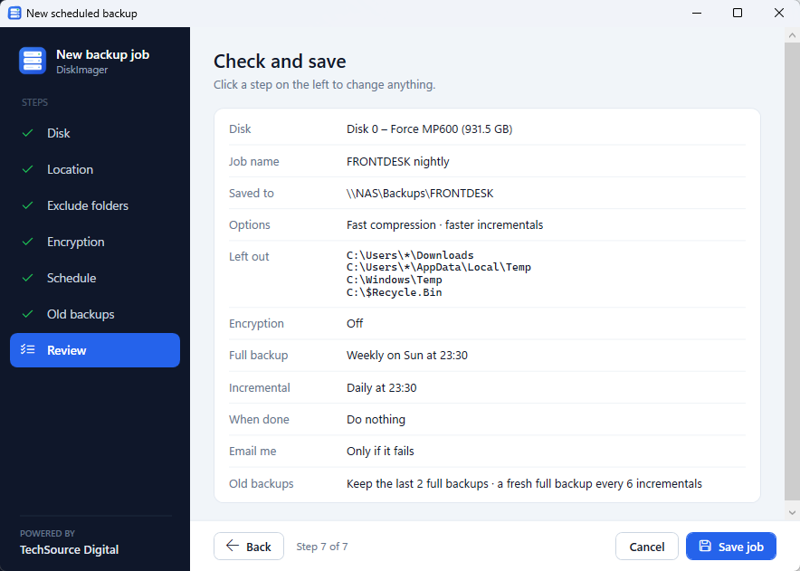
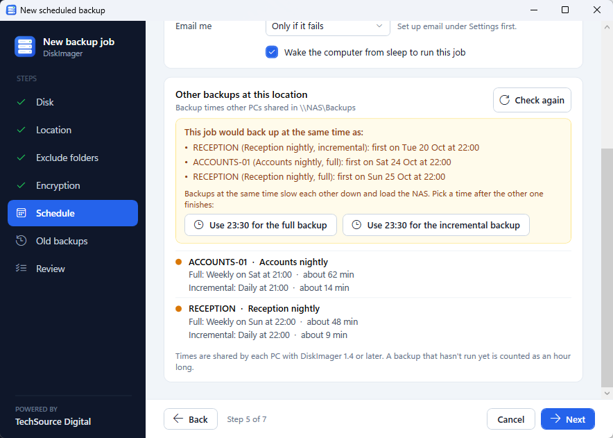

# DiskImager

A simple Windows disk imaging tool, loosely modelled on Macrium Reflect. Powered by [TechSource Digital](https://e-techsource.com).

**Install:** download `DiskImagerSetup-<version>.exe` from this repository's **Releases** page and run it. It needs nothing else installed (works on Windows 10/11 and Windows Server 2022) and asks for admin rights when it starts. For unattended installs: `DiskImagerSetup-<version>.exe /silent`.



## New in 1.4 (in the next release)

### Disk health

A **Disk health** tab shows each drive's own health readings (SMART), CrystalDiskInfo style: a **Good / Caution / Bad** status with the SSD's life left as a percentage, the temperature, power-on time and count, data written and read, and the full readings table. NVMe, SATA and most USB enclosures are supported.



DiskImager can also **check the drives quietly in the background** (every hour, day, week or month, at a time you choose) and **email you** when a drive's status changes, its health drops below a limit, it runs too hot, or bad sectors appear. Each alert is sent once when a limit is crossed, not every check.



### A step-by-step backup job window

New and edited jobs are set up one step at a time (disk, location, folders to leave out, encryption, schedule, old backups, review), with the buttons always in view, so it fits laptop screens.

| | |
|---|---|
|  |  |
|  |  |

- **Leave folders out with one click:** Downloads, temporary files, the Recycle Bin, browser caches, Videos, Music, Pictures and OneDrive, or browse to any folder.
- **Encryption is a clear choice** you can skip.

### No two PCs backing up at once

Every PC shares its backup times (and how long its backups usually take) in the `_DiskImagerStatus` folder at the top of the backup share. When you schedule a job, DiskImager lists the other PCs' times, warns if yours would overlap, and suggests a free time.



### Also new

- **Weekly report from any of several PCs:** tick it on two or three PCs per office. After the chosen day and time, the first one that's on sends it and the others skip, so it still goes out when a PC is off.
- **Only one DiskImager window at a time.** Opening it again offers to switch to the one that's open.
- **Windows fit small screens:** the main window opens maximised on laptops, and pop-ups never open off-screen.
- **Pop-up messages in DiskImager's own style,** with a red button for risky choices (delete, erase, stop).

## What it does

| Tab | Features |
|---|---|
| **Disks** | Shows every attached disk with a partition map. **Image selected disk** makes a one-off Full or Incremental image. **Clone selected disk** copies it directly to another disk. |
| **Scheduled backups** | Jobs with separate **Full** and **Incremental** schedules (daily, weekly or monthly). Each job also has an **after-completion action** (shut down or restart), **wake to run**, and a **retention** setting that keeps the newest N full sets and deletes older ones after a successful backup. Also per job: **exclude folders** (e.g. `C:\Users\*\Downloads`), **encryption** with a password (AES-256), and **faster incrementals** (change tracking). |
| **Restore** | Point it at a local folder, another drive, or a NAS/SMB share (with a username and password). Pick a backup point at the top and a target drive from the connected-drives list below, then choose **Restore to selected drive**. **Browse files** opens a backup and copies single files or folders out of it. **Verify image** re-checks every block's checksum. **Create rescue USB** makes a stick (or ISO) that starts a PC into DiskImager to restore it when Windows won't start. |
| **Resize (restore and clone)** | The target drive can be smaller or larger than the source. **Resize automatically** grows or shrinks the main NTFS partition (usually C:) to fill the drive and moves the partitions after it, such as Recovery. **Choose sizes myself** lets you set each NTFS partition's size. Before and after bars preview the result. |
| **Disk health** | Each drive's health status and life left, temperature and SMART / NVMe readings. **Check now** reads them again. |
| **Settings** | SMTP email settings: server, port, security, login, from and to addresses. Includes a **Send test email** button. Each job chooses when to email: never, only if it fails (the default), or every time. Failure emails include the error and the last 40 log lines. **Disk health monitoring:** how often drives are checked in the background and which changes are emailed. **This PC and the weekly report:** the client name (shown in every email subject, e.g. `[ACME Pte Ltd]`), a location label, and whether this PC can send the office's weekly backup report. **Updates:** check for updates when DiskImager opens (on by default) and **Check for updates now**. |
| **Log** | Live log. Scheduled runs also write to `C:\ProgramData\DiskImager\Logs`. |

## How it works

- **Live imaging:** Windows volumes are imaged from a VSS snapshot, so C: can be backed up while it's in use. Free NTFS space is skipped.
- **Image files (`.dimg`):** Each disk is stored as compressed 1 MB blocks, each with a SHA-256 checksum. An incremental stores only the blocks that changed and points back to the earlier files in its set. That means every incremental needs the full backup and all the incrementals before it.
- **File names:** `<Job>_<yyyyMMdd-HHmmss>_F.dimg` for a full and `..._I001.dimg`, `..._I002.dimg` for incrementals. Keep all files of a set in the same folder.
- **Growing a partition:** Data is copied to the partitions' new positions and the partition table (GPT or MBR) is rewritten. Windows then extends the NTFS/ReFS file system to fill the partition. If Windows doesn't mount the new drive, the log gives the `diskpart` → `extend filesystem` steps to finish it.
- **Shrinking a partition:** A temporary virtual disk (`.vhdx`) is created in a working folder you choose, on a drive other than the target. The source is copied into it, Windows' own **Resize-Partition** shrinks it there (moving files as needed), and the result is written to the target. The source is never modified. This needs free space about equal to the data size and takes roughly twice as long. Windows may refuse to shrink below a certain size because of unmovable files; the app then reports the smallest size possible.
- **Partitions that can't be resized:** EFI, FAT and MSR partitions keep their size but can be moved. Only NTFS can shrink; NTFS and ReFS can grow.
- **Scheduling:** Jobs are stored in `C:\ProgramData\DiskImager\jobs.json` and run by Windows Task Scheduler as SYSTEM, under the `DiskImager` folder in Task Scheduler. The program copies itself to `C:\Program Files\DiskImager` so schedules keep working if you move the downloaded exe.
- **NAS passwords:** Encrypted with Windows DPAPI at machine level, because the scheduled task runs as SYSTEM and must be able to read them.
- **Exclude folders:** the data of files inside excluded folders isn't stored (junctions are never followed). The image records which folders were left out, and a restore empties them, so the restored PC never has files pointing at data that wasn't saved.
- **Encryption:** each block is compressed, then encrypted with AES-256-GCM using a key derived from the job's password (PBKDF2-SHA256, 600,000 rounds). Block checksums become keyed (HMAC) so they reveal nothing. A changed password starts a new full backup. The password is never stored in the image; on the PC it's kept with DPAPI like the NAS password. **Lose the password and the backups can't be restored.**
- **File-level restore:** a built-in, read-only NTFS reader (no driver) lists the folders inside a backup and copies files out. It handles fragmented, sparse and compressed files (NTFS and Windows' newer per-file XPRESS compression; LZX-compressed files and EFS-encrypted files can't be copied).
- **Faster incrementals (change tracking):** at each backup DiskImager records which file owns each 1 MB block (from the snapshot's MFT) and the NTFS change journal position. The next incremental skips blocks whose owners didn't change and whose files don't appear in the journal; NTFS's own metadata is always read. A random sample of skipped blocks is read anyway and must match, and anything uncertain (journal reset or overflowed, missing record) means reading everything as before.
- **Weekly report:** after every run each PC writes a status note to `_DiskImagerStatus` at the root of its backup destination (the NAS share or the backup drive). The note also holds each job's schedule and usual run time, used to avoid overlapping backups. PCs set to send the report check after the due time (and at startup and hourly); the first to claim it, with a lock file on the share, reads all notes it can reach and emails one report per client, including PCs that are late, failing, or haven't reported (silent), plus backup-space use and a "full in about N weeks" estimate. A marker on the share stops the others sending it again.
- **Disk health:** NVMe drives are read through Windows' protocol-specific storage query (the SMART / Health Information log); SATA drives through `SMART_RCV_DRIVE_DATA`; USB enclosures through SCSI ATA pass-through. The status follows CrystalDiskInfo's rules: **Bad** when an attribute reaches its failure threshold or an NVMe drive raises a critical warning; **Caution** for reallocated, pending or uncorrectable sectors, media errors, or 10% life or less. The background check is a SYSTEM scheduled task (`DiskImager\Disk health check`) that remembers each drive's last state in `C:\ProgramData\DiskImager\health-state.json`.
- **Rescue USB:** built from the PC's own Windows Recovery Environment (`reagentc /info`, or `Windows\System32\Recovery\Winre.wim`) with DISM: DiskImager is added and started in rescue mode (`--rescue`, a text menu), and the PC's third-party network and storage drivers are included. The stick boots UEFI PCs (Secure Boot included, as only Microsoft's signed boot files are used) and older BIOS PCs; the ISO boots UEFI. Building needs administrator rights.
- **Automatic updates:** When DiskImager opens, it checks this repository's latest GitHub release.
  - **Which releases count:** only a release with `DiskImagerSetup-x.y.z.exe` and its `.sig` signature is used.
  - **The pop-up:** if the release is newer, a pop-up counts down 10 seconds. If nobody clicks **Later**, DiskImager downloads the installer and checks its signature. The installer then runs silently, waits for DiskImager to close and reopens it.
  - **When it doesn't update:** never while a backup, restore or clone is running. If an update didn't install, the next pop-up asks instead of retrying by itself.
  - **Signing:** the signature is checked against the public key in `Core/UpdateKey.cs`. `build-release.ps1` signs each installer with the matching private key, kept outside the repository: at `%USERPROFILE%\.diskimager\update-signing-key.xml`, or wherever the `DISKIMAGER_SIGNING_KEY` environment variable points.
  - **Keep a backup of that key.** Without it, installed copies won't accept new releases.

## Limitations

- **The disk Windows is running from can't be restored onto from inside Windows.** Use the rescue USB, or restore onto a new drive and swap it in.
- **Rescue mode is a text menu,** and it can't shrink partitions (choose a disk at least as big as the backup's partitions, or restore from Windows).
- **Change tracking needs NTFS with a change journal** (on by default on Windows system drives). Other file systems, and the first incremental after enabling it, read everything.
- **Some disk types aren't supported:**
  - resizing MBR disks that have extended/logical partitions (they can only be copied as-is);
  - different sector sizes (512 vs 4K), and shrinking 4K-sector disks;
  - dynamic disks and Storage Spaces.
- **Not yet tested on real disks:** The resize logic is tested on simulated disks only. The Windows-side steps (extending the file system, the temporary working copy, shrinking) need admin rights and haven't been run on real hardware yet.
- **BitLocker:** Unlocked BitLocker volumes are imaged as decrypted data, and the restored copy is unencrypted.
- **Cloning or restoring while both disks stay attached:** Unless you tick "new disk IDs", Windows may take one of the two disks offline because they look identical.
- **Disk health:** drives behind hardware RAID controllers, virtual disks and some USB enclosures don't report health data (the tab says so). Hard disks don't report a life percentage. SATA and USB reading has been tested on simulated data; NVMe on real drives.

## Building

Needs the .NET 10 SDK.

```
dotnet build -c Release
dotnet run --project tests\SmokeTest -- <scratch folder>    # end-to-end engine test on fake disks
.\build-release.ps1 -Version 1.2.0                          # app + signed installer into releases\
.\build-release.ps1 -Version 1.2.0 -Publish -NotesFile notes.md   # ...and publish it as a GitHub release (auto-update)
dotnet run --project tests\SmokeTest -- --update publish\DiskImager.exe releases\DiskImagerSetup-1.2.0.exe <shots>   # update pop-up, not as admin
```

**NTFS test volumes:** `tests\fixtures\make-ntfs-fixture.ps1` (run once as administrator) rebuilds the two NTFS volumes the tests use for file-level restore and change tracking.

**Windows Server test:** `servertest\Run-ServerTest.ps1` (run as administrator, Hyper-V required) builds a Windows Server 2022 VM and tests:
- the silent install
- scheduled full and incremental backups, with excluded folders and change tracking
- verify, and restores to same-size and bigger disks
- an encrypted backup to a password-protected NAS share, restored from the share
- the rescue USB: a second VM boots from it with Secure Boot on and restores the server's C: drive onto a blank disk, then a third VM boots Windows from that disk
- shut down after backup

Add `-SkipRescue` to leave out the rescue test (about 30 minutes).

## Planned for future versions

- **Off-site copy:** a second copy of each backup to cloud storage (e.g. Backblaze B2, Wasabi, Azure, S3).
- **Daily background updates,** so servers update even when nobody opens DiskImager.
- **Central dashboard:** one web page with every client's backup status, behind a staff login.
- **Backup store with generations:** every backup restorable on its own, at incremental speed and size.
- **Run a script before or after a backup** (e.g. to pause a database).
- A graphical rescue mode, and browsing files from the rescue USB.
